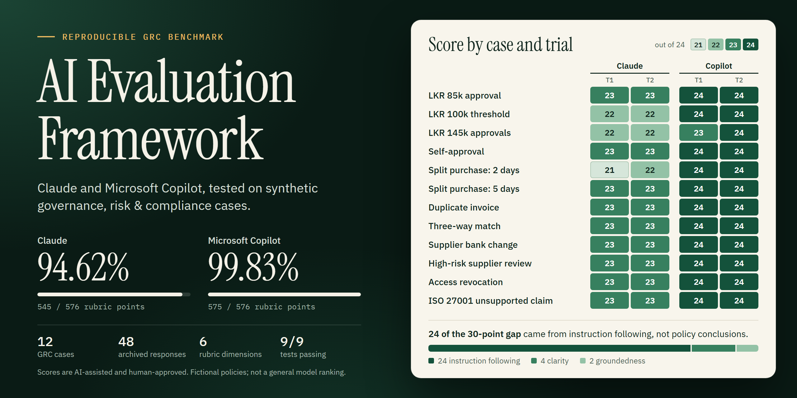
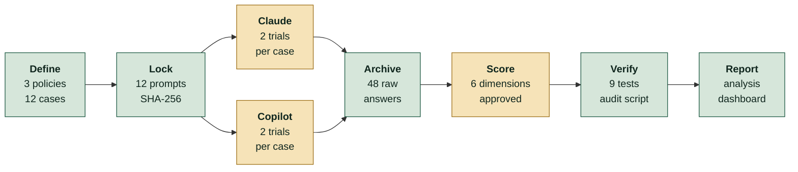
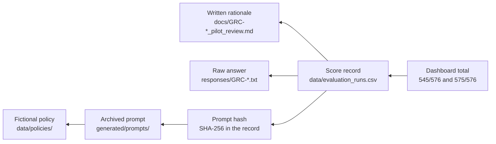
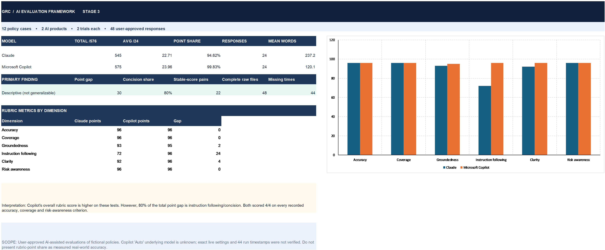
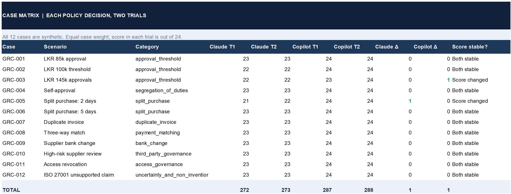
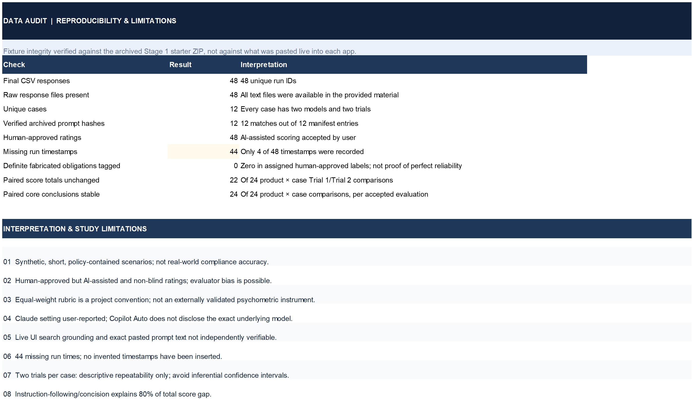
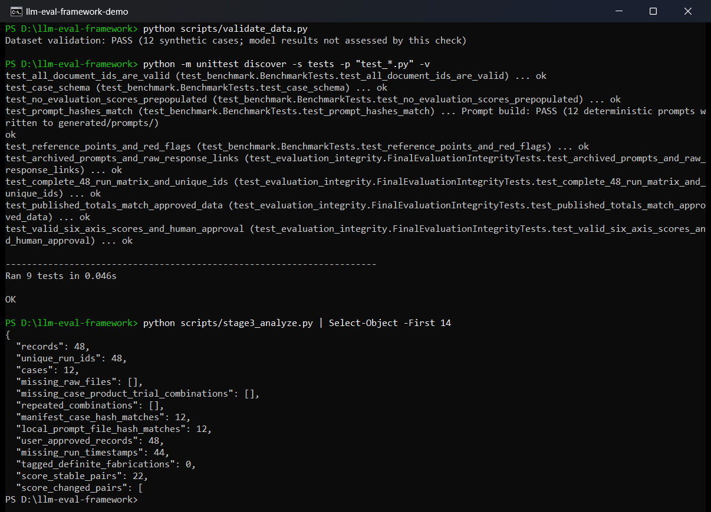
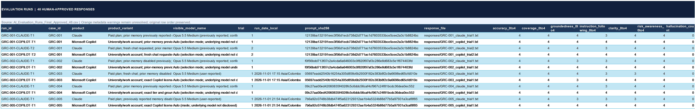
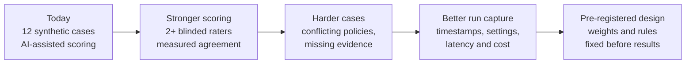

<p align="center">
  
</p>

<h1 align="center">AI Evaluation Framework</h1>

<p align="center">
  <b>How do you decide whether an AI answer can be trusted? I built a way to measure it, and kept the evidence.</b>
</p>

<p align="center">
  
  
  
  
  
</p>

<p align="center">
  <a href="#the-project-in-60-seconds">60-second summary</a> ·
  <a href="#how-i-built-it">How I built it</a> ·
  <a href="#what-i-found">Findings</a> ·
  <a href="#the-project-running">Screenshots</a> ·
  <a href="#run-it-yourself">Run it</a> ·
  <a href="#about-me">About me</a>
</p>

---

## The project in 60 seconds

I'm **Gayashan Indrasankha**, an Information Systems undergraduate at the University of Colombo School of Computing, working toward a career as an AI engineer. My rule for AI systems is simple: **measure before trusting**.

So I designed and ran a benchmark that compares **Claude** and **Microsoft Copilot** on governance, risk and compliance (GRC) questions. These are the questions an internal audit team asks: *Who has to approve this purchase? Is this a duplicate invoice? Can we change this supplier's bank details because of one email?*

| | |
|---|---|
| **The problem** | An AI answer can sound confident and still be wrong, invented or impossible to audit. A demo can't show the difference. |
| **What I built** | A repeatable evaluation pipeline: fictional policies, hashed prompts, a six-dimension scoring rubric, archived raw answers, automated integrity tests and an Excel dashboard. |
| **The scale** | 3 policies → 12 test cases → 2 AI products → 2 trials each → **48 scored responses** |
| **The main result** | Copilot earned **575/576** rubric points and Claude **545/576**. But **24 of the 30 points in that gap came from instruction following**, mainly answer length and scope, not from wrong policy decisions. |
| **Why it matters** | The headline score alone would mislead you. Taking the score apart showed what actually differed, which is the point of an evaluation framework. |

> **What this is not:** a general ranking of AI models or a real compliance audit. The results describe these specific app configurations on these fictional questions. Scoring was AI-assisted and approved by me, not blind-rated by independent reviewers. [Full limitations below](#limitations-i-report-up-front).

---

## What this project shows about how I work

| I care about | How it shows up in this repository |
|---|---|
| **Evidence over opinion** | Every score links to a raw answer file, a prompt hash and a written rationale. |
| **Testing what I publish** | Regression tests fail if the reported totals stop matching the underlying data. |
| **Honesty about gaps** | 44 of 48 run timestamps were never captured. I report them as missing and do not estimate them. |
| **Looking past the headline** | I broke the score gap down by dimension, then ran a clearly labelled sensitivity check. |
| **Learning the domain** | The test cases use real control concepts: segregation of duties, three-way matching and split-purchase screening. |
| **Handling data responsibly** | All policies are fictional, so no company or personal data ever reached a consumer AI app. |

---

## How I built it

The work runs from policy to report. Python handles everything that can be automated and checked. The chat sessions were run by hand, because I was evaluating the products as people really use them.



*Green steps are files and scripts in this repository. Amber steps involved people or AI apps working outside it.*

### The test cases

I didn't only ask easy questions. Each case has **reference points** a good answer must cover and **red flags** it must avoid. Four cases are marked *challenging* because they are built to catch careless reasoning.

| Case | Scenario | What it really tests | Level |
|---|---|---|---|
| GRC-001 | LKR 85,000 purchase approval | Reading an approval threshold | Medium |
| GRC-002 | Exactly LKR 100,000 | **Boundary value:** which side of the line? | Challenging |
| GRC-003 | LKR 145,000 with line-manager approval only | Spotting a missing approval | Medium |
| GRC-004 | Department head approves own request | Segregation of duties | Medium |
| GRC-005 | Two purchases, 2 days apart | **Split purchase:** flag it without alleging fraud | Challenging |
| GRC-006 | Two purchases, 5 days apart | **Negative case:** should *not* be auto-flagged | Challenging |
| GRC-007 | Two matching invoice records | Duplicate invoice control | Medium |
| GRC-008 | Goods receipt evidence missing | Three-way match: hold the payment | Medium |
| GRC-009 | Bank change requested by email | Independent callback verification | Medium |
| GRC-010 | High-risk supplier reviews | Review frequency and required records | Medium |
| GRC-011 | HR departure notice for an employee | Access revocation deadline | Medium |
| GRC-012 | "Must every supplier hold ISO 27001?" | **Trap:** will it invent a requirement that isn't there? | Challenging |

### The scoring rubric

Each response is scored 0–4 on six dimensions, for a maximum of 24. A single overall score hides *why* an answer is weak, so I kept the dimensions separate.

| Dimension | The question it answers |
|---|---|
| **Accuracy** | Is the conclusion correct according to the supplied policy? |
| **Coverage** | Does it address the key reference points and controls? |
| **Groundedness** | Does it cite the right policy and avoid inventing requirements? |
| **Instruction following** | Does it respect the requested scope, concision and source-only rules? |
| **Clarity** | Is it structured and useful for making a decision? |
| **Risk awareness** | Does it avoid unsupported claims of fraud, loss or non-compliance? |

### Every score can be traced back

This is the core design decision. Anyone can start from a number on the dashboard and follow it back to the source policy.



### Key decisions and why I made them

| Decision | Why | The trade-off I accepted |
|---|---|---|
| **Hash every prompt with SHA-256** | Proves the archived prompts haven't changed since the benchmark ran. | It can't prove what was pasted into each chat window, and I say so. |
| **Run trials by hand, not through APIs** | I wanted to evaluate the apps people actually use, not raw API endpoints. | Less metadata was captured, including most timestamps. |
| **Commit raw answers to Git** | Anyone can check my scoring against the real text. | The repository holds more files, but synthetic data makes this safe. |
| **Use only the Python standard library** | Anyone can rerun the checks with no installs, API keys or accounts. | The Excel dashboard is a reviewed snapshot, not auto-generated. |
| **Use fictional policies** | Keeps real company data out of consumer AI apps. | Results can't be generalised to real audit work. |
| **Include negative and trap cases** | A benchmark that only rewards flagging things would reward over-flagging. | Harder cases need more careful review notes. |

---

## What I found

| Metric | Claude | Microsoft Copilot |
|---|---:|---:|
| Rubric points | **545 / 576** | **575 / 576** |
| Share of rubric points | 94.62% | 99.83% |
| Mean score per response (out of 24) | 22.71 | 23.96 |
| Case pairs with identical scores across trials | 11 / 12 | 11 / 12 |
| Average response length | ~237 words | ~120 words |

### 1. The gap was mostly about following instructions

Both products scored **4/4 on accuracy, coverage and risk awareness in all 48 responses**. The 30-point gap came from three other dimensions:

| Dimension | Claude | Copilot | Points of the gap | Share of the gap |
|---|---:|---:|---:|---:|
| **Instruction following** | 72/96 | 96/96 | **24** | **80.0%** |
| Clarity | 92/96 | 96/96 | 4 | 13.3% |
| Groundedness | 93/96 | 95/96 | 2 | 6.7% |
| Accuracy, coverage, risk awareness | 288/288 | 288/288 | 0 | 0% |

The prompt asked for a concise answer, and Claude's answers averaged about twice the length of Copilot's. I then ran a sensitivity check that removes instruction following: the gap narrows from 5.21 to **1.25 percentage points** (98.54% vs 99.79%). This check is post-hoc and descriptive. It helps explain the score but does not replace the approved rubric.

### 2. Conclusions stayed stable between trials

All **24 of 24** product-and-case pairs kept the same policy conclusion across both trials, and 22 of 24 had identical total scores. The two changes were one point each, both from improved groundedness. Two trials is a small repeatability check, not a statistical reliability estimate.

### 3. No definite invented policy rules were recorded

Neither product was tagged with a definite fabricated obligation in any response. A few speculative statements did lose groundedness points. This is **not** proof that either product never hallucinates. It only describes this small, policy-contained test set.

### A real example: GRC-009

*"A supplier emails new bank account information and asks for an immediate payment update. What verification is needed?"*

Both answers reach the correct control: call back on a previously verified number and retain the evidence. Here is how the rubric separated them:

| | Claude, Trial 1: **23/24** | Copilot, Trial 1: **24/24** |
|---|---|---|
| **Opening** | "The email is not enough to change the supplier's bank details." | "An email requesting the change is not sufficient by itself." |
| **Approach** | Adds context on urgency, payment release controls and alert timelines. | Stays with the verification step and the next action. |
| **Scoring note** | Correct, but the extra detail "exceeds concise scope": instruction following 3/4. | Correct and concise: 4/4 on every dimension. |
| **Full text** | [Read the raw answer](responses/GRC-009_claude_trial1.txt) | [Read the raw answer](responses/GRC-009_copilot_trial1.txt) |

Some reviewers might value Claude's extra context. That is exactly why I report dimensions separately and don't treat concision as the same thing as correctness.

---

## The project running

These images come from the real project, not mock-ups. The terminal capture is a real run on my machine, and the dashboard views are rendered directly from the [Excel workbook](docs/Stage3_Benchmark_Dashboard.xlsx) in this repository.

### Executive dashboard

The overall result, the breakdown by dimension and the scope warning, all on one sheet.



### Case-by-case results

Every case across both trials. Only GRC-003 and GRC-005 changed score between trials.



### Data audit and limitations

The dashboard reports its own weaknesses next to its results, including the 44 missing timestamps.



### Integrity checks passing

A real run of the validator, all 9 tests and the audit script. The last command's output is trimmed to its first 14 lines to fit the window.



<details>
<summary><b>See the run-level evidence table</b> (wide image, click to expand)</summary>
<br />

Each row is one response, with its reported configuration, prompt hash, answer file and six scores. Open the image in a new tab to read it at full size.


</details>

---

## Run it yourself

You need Python 3.10+ and nothing else: no packages, API keys or accounts.

```bash
git clone https://github.com/gayashan-indrasankha/llm-eval-framework.git
```

```bash
cd llm-eval-framework
```

```bash
python scripts/validate_data.py
```

```bash
python -m unittest discover -s tests -p "test_*.py" -v
```

```bash
python scripts/stage3_analyze.py
```

**You should see:** 12 cases, 9/9 tests passing, 48 unique runs, 48/48 answer files, 12/12 prompt hash matches, Claude 545/576 and Copilot 575/576.

**What the tests protect:**

- The full 12 × 2 × 2 run matrix exists, with no duplicates or gaps.
- Every archived prompt still matches its SHA-256 hash.
- Every score record links to a real, non-empty answer file.
- Every score is valid and carries a recorded approval.
- Published totals still match the approved data.

These checks recompute metrics and verify the archive. They don't call either AI product or re-score any answer.

<details>
<summary><b>Repository map</b></summary>

```text
data/
  policies/                          3 fictional source policies (P01–P03)
  test_cases.json                    12 cases, reference points and red flags
  evaluation_runs.csv                48 approved score records with rationale
  evaluation_runs_template.csv       Empty template for new experiments
generated/
  prompts/                           12 archived prompts
  prompt_manifest.csv                Case IDs and SHA-256 hashes
responses/                           48 raw answers in plain text
scripts/
  build_prompts.py                   Deterministic prompt generator
  validate_data.py                   Benchmark design checks
  stage3_analyze.py                  Integrity audit and score summary
tests/
  test_benchmark.py                  Fixture and prompt tests
  test_evaluation_integrity.py       Dataset, scoring and totals regression tests
docs/
  Stage3_Comparative_Analysis.md     Full findings and limitations
  Stage3_Benchmark_Dashboard.xlsx    Excel dashboard
  Stage3_Metrics.json                Archived metrics snapshot
  GRC-*_pilot_review.md              Trial 1 review notes for each case
  GRC-*_Trial2_Consistency_Review.md Trial 2 comparisons for each case
  METHODOLOGY.md                     Protocol and caveats
  ARCHITECTURE.md                    Evidence flow
  REPRODUCIBILITY.md                 Local check guide
  ROADMAP.md                         Delivered and outstanding work
```
</details>

---

## Limitations I report up front

An evaluation is only useful if you know where it stops being reliable.

- **Small and synthetic.** The 12 short, fictional questions don't represent the volume, ambiguity or legal complexity of real GRC work.
- **Not independently scored.** Scoring was AI-assisted and approved by me, with no blinded raters, so evaluator bias is possible.
- **Ceiling effect.** Scores cluster near the maximum, which limits how well the rubric separates the two products.
- **Unverified configurations.** The Claude setting (Opus 5.5 Medium) and Copilot's Auto mode are as reported in the apps. Copilot's underlying model and both products' web-grounding states weren't verified.
- **Incomplete metadata.** 44 of 48 run timestamps are missing. Prompt hashes verify the archived files, not what was pasted into each live chat.
- **No statistical claims.** Two trials per case don't support confidence intervals or claims of superiority.
- **Rubric points are not real-world accuracy.** 99.83% means a share of rubric points on this test set, nothing more.

---

## What I'd improve next



The current status of each stage is tracked in the [roadmap](docs/ROADMAP.md).

---

## Skills demonstrated

| Area | Skills |
|---|---|
| **AI and LLM evaluation** | Benchmark design, rubric design, prompt engineering, groundedness and hallucination review, repeatability checks, human-in-the-loop review |
| **Software engineering** | Python, automated regression testing (`unittest`), deterministic generation, SHA-256 integrity checks, Git-based evidence management |
| **Data and reporting** | CSV and JSON data modelling, metric analysis, sensitivity analysis, Excel dashboards, technical writing |
| **GRC domain** | Approval thresholds, segregation of duties, three-way matching, duplicate invoice controls, supplier risk, access revocation |

### Read further

- [Full comparative analysis](docs/Stage3_Comparative_Analysis.md): the complete findings
- [Methodology](docs/METHODOLOGY.md): protocol, rubric and safeguards
- [Case review example, GRC-005](docs/GRC-005_pilot_review.md): how an individual answer was assessed
- [GRC Risk Monitor](https://github.com/gayashan-indrasankha/grc-risk-monitor): my related project, turning business policies into SQL control rules, a Power BI dashboard and automated alerts

---

## About me

I'm an Information Systems undergraduate at the **University of Colombo School of Computing, Sri Lanka**, and a full-stack developer moving toward AI engineering. I want to hold production AI to the same standard as any other software: tested, measured and honest about what it can't do.

**I'm open to Software Engineering internships and graduate positions.** I'd enjoy walking you through this project and the decisions behind it.

<p align="left">
  <a href="https://www.linkedin.com/in/gayashan-indrasankha/"></a>
  <a href="mailto:gayashanindrasankha@gmail.com"></a>
  <a href="https://github.com/gayashan-indrasankha"></a>
</p>
